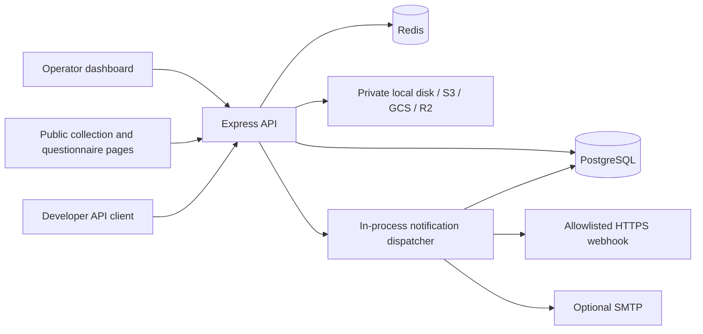

# System architecture

OpenKYC collects documents for manual identity review. The current system replaces the original Convex backend and TanStack Start/Netlify deployment with a self-hosted React SPA and Node API. The historical design is preserved in [the legacy README](legacy-readme.md); it does not describe the current runtime.

## Runtime components

| Component                        | Responsibility                                                                            | Source                                |
| -------------------------------- | ----------------------------------------------------------------------------------------- | ------------------------------------- |
| React, TanStack Router and Query | Dashboard, collection pages, forms, routing, API query cache                              | `src/`                                |
| Shared UI and contracts          | Reusable components and typed operation references/validation                             | `packages/ui/`, `packages/contracts/` |
| Express                          | Authentication routes, RPC and REST APIs, uploads, downloads, live events, built frontend | `server/index.ts`                     |
| Better Auth                      | Email/password accounts, sessions, magic links and password reset                         | `server/auth.ts`, `server/access.ts`  |
| PostgreSQL and Drizzle           | Tenant data, file metadata, API keys, auth tables and notification outbox                 | `server/db/`, `server/repository.ts`  |
| Redis                            | Single-use upload tickets, request rate counters and tenant update notifications          | `server/redis.ts`, `server/index.ts`  |
| Storage adapters                 | Private document bytes on local disk, S3, GCS or R2                                       | `server/storage.ts`                   |
| Notification dispatcher          | Signed webhook and optional email delivery with bounded retries                           | `server/webhooks.ts`                  |

Production serves the built SPA and `/api` from the same Express origin. Development uses Vite on port 3000 with an API proxy to port 3001. Compose runs PostgreSQL 17, Redis 7, FalkorDB, a one-shot migration service, and the app. Database and Redis health checks gate migrations; successful migrations gate app startup. See [deployment and operations](self-hosting.md).

## Ownership and data model

Each authenticated account is its own tenant: `ownerId` is the Better Auth user ID. The current model does not include shared organizations, invitations, or team roles. Repository queries scope application records to their owner; public collection and questionnaire endpoints use separate token-based access.

- `entities` stores workflows, collection sessions, documents, questionnaires, questions, responses, settings, blocklist entries, analyses, and review audit records. Records have an ID, owner, kind, optional parent ID, JSON data, and timestamps.
- `files` stores each object's owner, optional collection session, provider, bucket, object key, MIME type, size, and SHA-256 digest. File bytes live in private storage.
- `api_keys` stores key names, display prefixes, owners, and SHA-256 digests. Raw API keys are returned only when created.
- `jobs` stores notification payloads, status, attempts, retry availability, and delivery errors.
- Better Auth manages its own user, account, session, and verification tables in PostgreSQL.

Drizzle migrations and Better Auth schema migrations run through `npm run db:migrate` under a PostgreSQL advisory lock. Existing Convex data requires an explicit export/import with ownership mappings; see [migration instructions](migration.md).

## Document collection and review

1. An operator creates an active workflow and a collection session. The server creates a random public token and an expiry, defaulting to seven days unless configured otherwise.
2. The operator shares `/sessions/<sessionId>?token=<publicToken>`. Public access checks the token hash and expiry. The original token is retained in the owner's session record so the dashboard can display the collection link again.
3. The subject requests an upload ticket. Redis holds its owner/session association for five minutes. Uploading consumes the ticket once, validates the file signature and 20 MB size limit, and stores bytes through the selected adapter. A session accepts at most 20 documents.
4. The subject submits after at least one document has been uploaded. A database transaction marks collection complete and adds a `session.submitted` notification. Completed or expired sessions cannot accept more uploads or be reopened through public updates.
5. The operator downloads documents through the authenticated API and records an approval or rejection with notes. A transaction updates the review decision, appends an audit record, and adds a `session.reviewed` notification.

Collection state and review state are separate: a completed collection can still have a pending review. The application does not infer identity validity from an upload or a completed collection.

## API and live updates

The frontend calls named operations under `/api/rpc/:operation`. Integrations use `/api/v1` with a bearer API key scoped to its owner's tenant. Private document downloads use `/api/files/:id`; public collection tokens do not grant access to the owner's document library. Published questionnaires use `/api/public/questionnaires/:token` and render at `/forms/<token>`.

Authenticated browsers subscribe to `/api/events`. Redis publishes a `changed` signal on the owner's channel, and server-sent events tell TanStack Query to invalidate cached API data. Queries also refresh every 15 seconds. Events carry no document contents or session secrets, and PostgreSQL remains the source of truth.

See the [developer API and webhook protocol](api.md) for endpoints, authentication, upload limits, and event signatures.

## Notifications and optional integrations

The app polls the PostgreSQL notification outbox every five seconds. Claims use database locking to coordinate app instances; expired claims can be retried after a crash. Delivery attempts are bounded at five with exponential delay. Delivery is at least once, so receivers must deduplicate stable event IDs.

Webhook delivery requires an administrator-allowlisted HTTPS hostname and a tenant signing secret. Optional SMTP handles magic links, password reset, and review notifications. Optional Firecrawl integration supports background search. These integrations are independent of manual document collection.

There is no document-processing worker or RabbitMQ service. Face matching, document authenticity decisions, and malware scanning remain outside the current implementation. OCR extraction (Indra OCR service with a local Tesseract ensemble fallback), FalkorDB graph ingestion, nvidia/nemotron-3-embed-1b graph embeddings (`vecf32` vector indexes on :Document/:Person), automated AML/graph analytics — including DPRK IT-worker screening — run after submission; see [the OCR → graph → AML pipeline](../demo-data-e2e.md). The agentic compliance chat (`/agent`) answers operator questions over the same PostgreSQL records, FalkorDB graph algorithms, and OCR document nodes (keyword + embedding retrieval) with cited retrieval. Reviews remain manual: the AML report assists operators but does not auto-approve.

## Persistence and deployment boundaries

PostgreSQL stores durable application records and the notification outbox. Redis persists with AOF in Compose, but resetting it still invalidates pending upload tickets and rate counters. Local documents use the `document-data` volume; cloud storage uses private buckets with credentials configured on the server. Changing storage providers affects new uploads, so existing objects still require their original provider credentials.

Compose is a single-host setup. Shared local storage, reverse proxy configuration, backups, and external provider availability need to be accounted for before scaling beyond it. `/api/health` checks PostgreSQL and Redis; it does not validate cloud storage or SMTP credentials. Follow [self-hosting](self-hosting.md) for HTTPS, backups and upgrades, and [storage configuration](storage.md) for provider setup.
