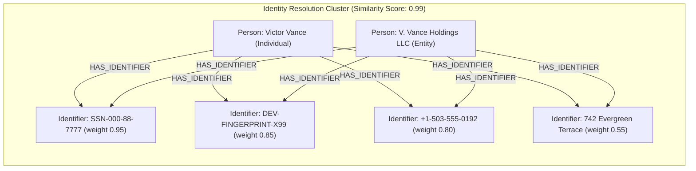
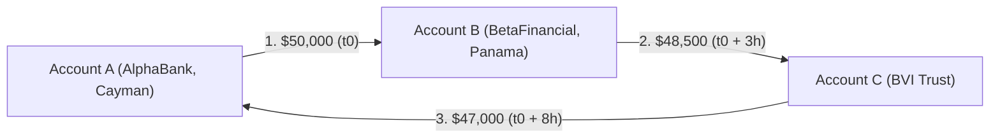
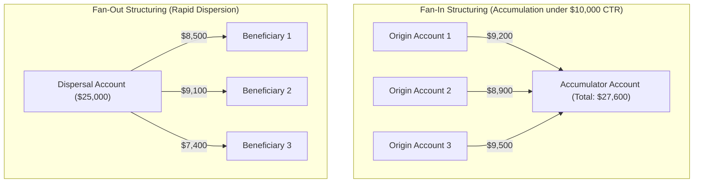
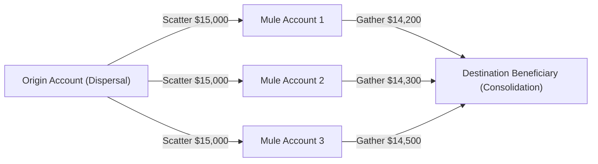
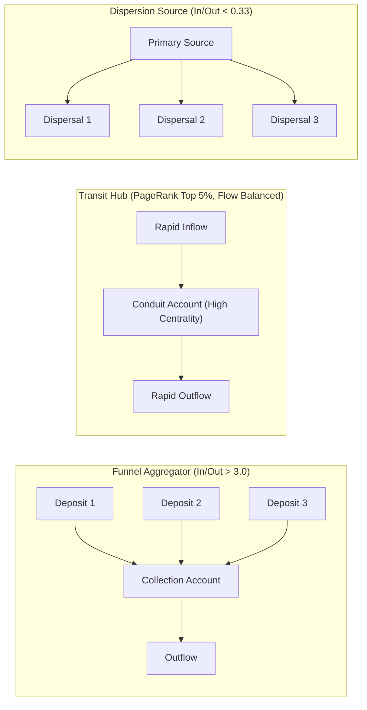
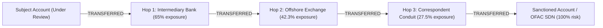
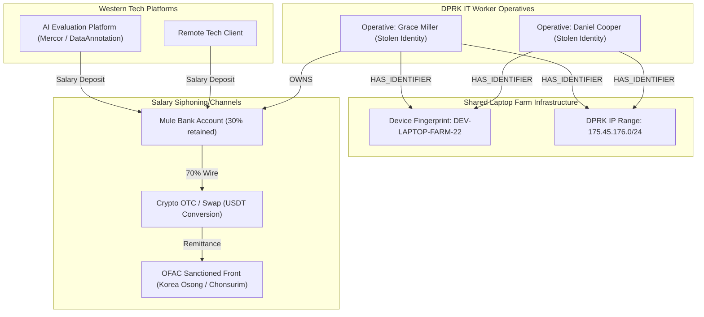

# @open-kyc/falkordb-aml

A high-performance Anti-Money Laundering (AML) graph algorithms and financial crime typology detection library powered by **FalkorDB**  and IBM AMLSim benchmark specifications.

---

## 🚀 Key Features & Implemented Typologies

Deterministic, graph-theoretic detectors implemented directly against FalkorDB, benchmarked against IBM AMLSim and real-world multi-national advisory typologies:

### 1. Entity Resolution & Identity Clustering (`entityResolution.ts`)
Discovers disparate applicants or customer profiles that share deterministic credentials (tax ID, phone, email, device ID, IP, address, document number) and groups them into unified identity clusters using graph connectivity.

```cypher
MATCH (p1:Person)-[:HAS_IDENTIFIER]->(i:Identifier)<-[:HAS_IDENTIFIER]-(p2:Person)
WHERE p1.id < p2.id
RETURN p1.id AS p1_id, p2.id AS p2_id, collect(i.type) AS shared_types, collect(i.val) AS shared_vals
```



### 2. Circular Flow & Round-Tripping Cycles (`cycleDetection.ts`)
Traverses directed cycles (3 to 5 hops) where funds loop back to the origin or affiliates to disguise the source of wealth: `(A) -> (B) -> (C) -> (A)`. Evaluates temporal bounds ($\le 720\text{ hours}$) and fund preservation rates ($\ge 60\%$).

```cypher
MATCH (a:Account)-[t1:TRANSFERRED]->(b:Account)-[t2:TRANSFERRED]->(c:Account)-[t3:TRANSFERRED]->(a:Account)
WHERE a.id < b.id AND a.id < c.id AND b.id <> c.id
RETURN a.id AS a_id, b.id AS b_id, c.id AS c_id, t1, t2, t3
```



### 3. Smurfing & Structuring (`smurfing.ts`)
Detects attempts to evade mandatory statutory Currency Transaction Reporting (CTR) thresholds ($10,000 / €10,000):
- **Fan-In (Aggregation)**: Multiple sub-threshold deposits ($5,000–$9,999) flowing into a single accumulator within 72 hours.
- **Fan-Out (Dispersion)**: Single account dispersing sub-threshold payments across multiple beneficiaries.



### 4. Scatter-Gather Mule Layering (`scatterGather.ts`)
Detects multi-path money-mule architectures: an origin account scatters funds across $N$ intermediate mule accounts, which promptly consolidate at a destination beneficiary within 24–72 hours to break simple audit trails.



### 5. PageRank & Flow Hub Centrality (`centrality.ts`)
Executes native GraphBLAS `CALL algo.pageRank('Account', 'TRANSFERRED')` and calculates In-Degree / Out-Degree volume flow ratios to classify accounts into operational roles:
- `funnel_aggregator`: In/Out ratio $> 3.0$ (collection point).
- `dispersion_source`: In/Out ratio $< 0.33$ (distribution point).
- `transit_hub`: High PageRank centrality with balanced flows (pass-through conduit).



### 6. Sanctions & PEP Exposure Tracing (`riskTracing.ts`)
Traces multi-hop paths up to 4 hops away from OFAC / SDN / PEP flagged entities, applying distance-decay exposure scoring:

$$\text{Exposure Score} = \text{BaseRisk} \times 0.65^{\text{hops}}$$



### 7. DPRK Remote Worker & Laptop-Farm Screening (`nkWorkerDetection.ts`)
Screens contractor identities and payment paths against the July 2026 multi-government advisory across 8 weighted indicators:
- Shared laptop-farm device fingerprints and connection IPs.
- Verification sessions originating from the DPRK-allocated IP block (`175.45.176.0/24`).
- Reused identity documents / tax IDs.
- Outbound salary routing to cryptocurrency exchanges/swaps or OFAC-designated revenue fronts (Korea Osong, Chonsurim).



### 8. Weakly Connected Components (WCC) (`wcc.ts`)
Partitions the global transaction graph into isolated payment rings and transaction subnetworks using native `CALL algo.WCC()`, computing internal transaction volumes, node counts, and risk density per component.

### 9. Unified AML Risk Engine & SAR Generation (`riskScorer.ts`)
Aggregates all topological signals into an overall 0–100 Risk Score, categorizes risk levels (`CLEAN`, `LOW`, `MEDIUM`, `HIGH`, `CRITICAL`), and generates Suspicious Activity Report (SAR) narratives citing the exact graph evidence for compliance escalation.

---

## 📦 Installation & Setup

```bash
# Within the open-kyc monorepo:
npm install
```

Ensure FalkorDB is running:
```bash
docker compose up -d falkordb
```

---

## 💡 Quick Start Example

```typescript
import {
  FalkorDBClient,
  AMLDataLoader,
  createBenchmarkAMLDataset,
  CycleDetector,
  SmurfingDetector,
  AMLRiskScorer,
} from '@open-kyc/falkordb-aml'

// 1. Initialize client
const client = new FalkorDBClient({
  host: '127.0.0.1',
  port: 6380,
  graphName: 'production_aml_graph',
})

// 2. Ingest benchmark or real transaction data
const loader = new AMLDataLoader(client)
const dataset = createBenchmarkAMLDataset()
await loader.loadDataset(dataset)

// 3. Detect Smurfing & Structuring
const smurfingDetector = new SmurfingDetector(client)
const smurfing = await smurfingDetector.detectSmurfing({
  reportingThreshold: 10000,
  structuringFloor: 5000,
  minTransactions: 3,
})
console.log('Smurfing alerts:', smurfing.fanInStructuring)

// 4. Detect Round-Tripping Cycles
const cycleDetector = new CycleDetector(client)
const cycles = await cycleDetector.detectCycles({ minHop: 3, maxHop: 4 })
console.log('Circular flows found:', cycles.detectedCycles)

// 5. Evaluate Account & Generate SAR Report
const scorer = new AMLRiskScorer(client)
const report = await scorer.evaluateAccount('ACC_AGGREGATOR_MAIN')
console.log('AML Risk Score:', report.riskScore) // e.g. 85 (HIGH)
console.log('Recommended Action:', report.recommendedAction) // FILE_SAR
console.log('SAR Narrative:', report.suspiciousActivitySummary)
```

---

## 🧪 Testing

Run the test suite against live FalkorDB:

```bash
npm test
# Or run specifically:
npx vitest run packages/falkordb-aml/test/falkordb-aml.test.ts
```
