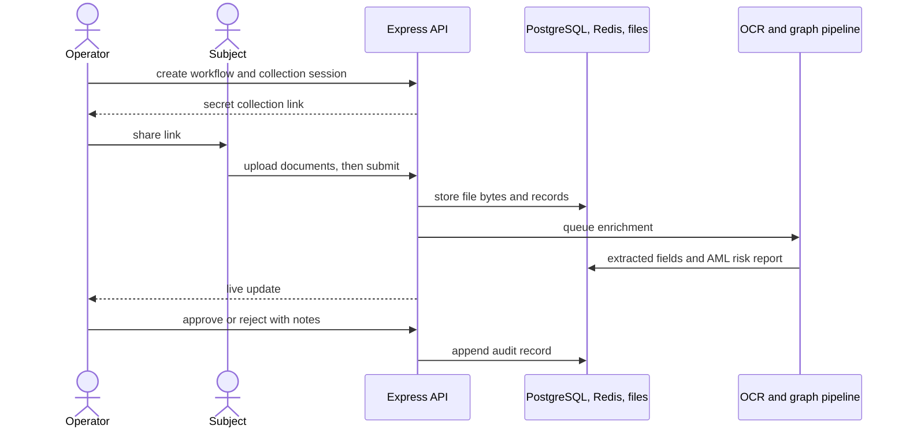
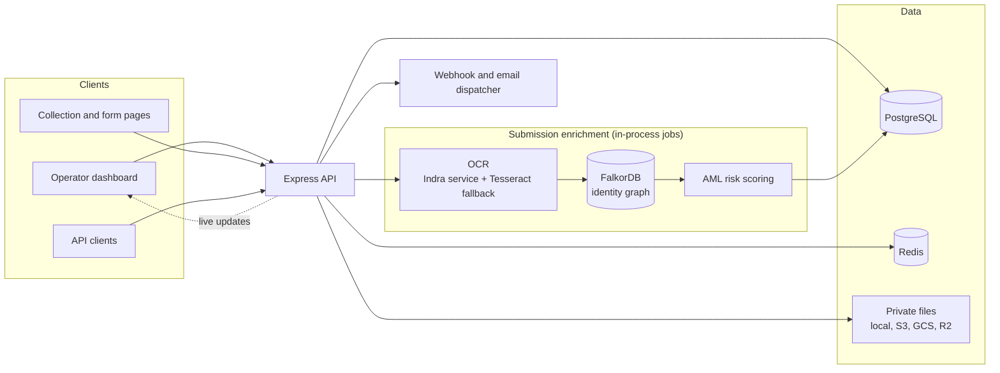

# OpenKYC

Self-hosted know-your-customer (KYC) application for document collection and manual identity review. Operators build workflows, share secret collection links, and review submissions from a tenant-scoped dashboard. Optical character recognition (OCR) and graph-based anti-money laundering (AML) analysis assist the reviewer; the decision stays manual.

## Showcase


| Workflows | Verifications |
| :---: | :---: |
|  |  |

| Agentic chat | Brand customization |
| :---: | :---: |
|  |  |

## How it works



Collection and review are separate states: a completed collection can still have a pending review, and the application does not infer identity validity from an upload.

## Architecture



| Component | Responsibility |
| --- | --- |
| React SPA | Operator dashboard, collection pages, questionnaire forms |
| Express | Auth routes, RPC and REST endpoints, uploads, downloads, live events, built frontend |
| PostgreSQL + Drizzle | Tenant records, file metadata, API keys, notification outbox, migrations |
| Redis | Single-use upload tickets, rate limits, live-update pub/sub |
| Storage adapters | Private document bytes on local disk, S3, GCS, or R2 |
| FalkorDB + `@open-kyc/falkordb-aml` | Identity graph, embeddings, graph-algorithm AML scoring |
| OCR | Indra service with a local Tesseract ensemble fallback |
| Notification dispatcher | Signed webhooks and email with bounded retries |

Production serves the SPA and `/api` from one Express origin. Compose runs PostgreSQL 17, Redis 7, FalkorDB, OCR, a one-shot migration service, and the app. The app starts after migrations finish. Enrichment runs inside the app process. Without FalkorDB or OCR, sessions settle with `amlStatus=unavailable` instead of blocking review.

## Quickstart

Requires Node.js 22+ and Docker Compose v2.

```sh
git clone https://github.com/biomathcode/aml-graph.git
cd open-kyc
npm run setup
```

`npm run setup` writes `.env` with random secrets (without overwriting an existing file), builds the images, starts the stack, and waits for the health check. Open [localhost:3000](http://localhost:3000), create an account, create an active workflow, and create a verification session. Share the generated link.

## Included

- **Collection**: expiring secret links, PDF/JPEG/PNG/WebP uploads up to 20 MB, 20 documents per session, filename search, private downloads.
- **Review**: approval or rejection with notes, audit history, blocklist signals, dashboard analytics.
- **Enrichment**: OCR field extraction; FalkorDB ingestion; AML scoring for cycles, structuring, scatter-gather layering, entity resolution, centrality, sanctions exposure, and DPRK IT-worker screening; graph embeddings (`nvidia/nemotron-3-embed-1b`); a cited compliance chat at `/agent`.
- **Integrations**: developer API keys and REST endpoints, signed webhooks with delivery status, SMTP notifications, optional Firecrawl search.
- **Platform**: Better Auth email/password with optional SMTP magic links and password reset, tenant-scoped queries, questionnaires, a billing view for self-hosted usage, live updates.
- **Storage**: local disk, AWS S3, Google Cloud Storage, Cloudflare R2.

## AML analysis

Completed submissions are ingested into FalkorDB as `:Person`, `:Document`, `:Identifier`, and `:Account` nodes, then scored by deterministic detectors (`@open-kyc/falkordb-aml`) — no LLM decides the verdict. Detectors emit typed signals with the graph evidence behind them, and the signals sum into a 0–100 risk report on the session.

### Two customers, one culprit

The `falkordb-aml` package ships a synthetic IBM-AMLSim-style benchmark graph (`packages/falkordb-aml/src/dataset/ibmAMLSim.ts`) that its tests and the agent's demo knowledge base load. Two of its records look unrelated at onboarding:

| Customer | Account | Relationship | Looks fine because |
| --- | --- | --- | --- |
| Victor Vance — individual, Springfield OR | ACC_CYCLE_A (CYC-001, AlphaBank, Cayman shell) | owner | plausible private-banking customer |
| V. Vance Holdings LLC — company | ACC_CYCLE_B (CYC-002, BetaFinancial, Panama shell) | signatory | plausible corporate customer |

Four graph facts expose what a per-customer review cannot see:

1. **A round trip.** $50,000 leaves `ACC_CYCLE_A`, arrives as $48,500 at `ACC_CYCLE_B`, moves as $47,000 to `ACC_CYCLE_C` (BVI trust), and returns to `ACC_CYCLE_A` — all within 8 hours, with 94% of the money preserved. The cycle detector flags 3–5 hop loops that keep ≥60% of funds for ≤30 days and scores this one 0.95, emitting a **high** `round_tripping_cycle` signal on every subject whose account sits on the path.
2. **One owner, two identities.** Both records share the same phone, tax ID (`SSN-000-88-7777`), device fingerprint (`DEV-FINGERPRINT-X99`), and address. Entity resolution weights shared identifiers — document number 1.0, tax ID 0.95, device 0.85, phone 0.8, email 0.75, IP 0.65, address 0.55 — and above the 0.65 threshold the pair resolves into one identity cluster at 99% confidence: a **medium** `entity_resolution_cluster` signal. The company is not a second customer; it is the same beneficial owner on the other side of the loop.
3. **The hub.** `ACC_CYCLE_B` ranks among the graph's top PageRank hubs (0.284), so its signatory also receives a **high** `high_centrality_account` signal naming the account's flow-hub role.
4. **The verdict.** The company's report sums to 88/100 — **critical** (≥70 critical, ≥45 high, ≥25 medium, ≥10 low) with "review the signals and consider escalation". A customer whose accounts touch none of the patterns instead gets only the informational `no_active_typologies` signal: 3/100, clean.

The same detector run covers structuring (fan-in/fan-out below the $10,000 reporting threshold), scatter-gather mule layering, and distance-decayed sanctions exposure (0.65 decay per hop, up to 4 hops), so the reviewer sees the whole picture before approving.

### Detecting a North Korean IT worker in your organization

North Korean IT workers take remote positions under falsified — often stolen — identities, appear domestic by working through third-party "laptop farms", and route their salaries (frequently in cryptocurrency) to DPRK front companies. Paying them can violate sanctions law: UNSCR 2397 requires repatriating DPRK nationals earning income in your jurisdiction, FATF keeps the DPRK on its call-for-action blacklist, and OFAC designates the front companies that collect the revenue.

Every person in the graph is scored against eight weighted indicators modeled on the July 2026 multi-government advisory:

| Indicator | Points | What OpenKYC checks |
| --- | --- | --- |
| I1 DPRK identity claim | 40 | Registered nationality is North Korean / DPRK. |
| I2 Third-party identity reuse | 25 | Tax ID or document number already attached to another profile. |
| I3 Laptop-farm infrastructure | 25 | Device fingerprint or IP shared across distinct identities. |
| I4 DPRK IP range | 30 | Sessions originating from 175.45.176.0/24, the DPRK-allocated block. |
| I5 Crypto remittance demand | 20 | Income received via crypto exchange/swap instead of payroll. |
| I6 Front-company remittance | 35 | Outbound funds to OFAC-designated fronts (Korea Osong Shipping Co, Chonsurim Trading Corporation, Liaoning China Trade Industry). |
| I7 Proxy-jurisdiction accounts | 15 | Accounts domiciled in PRK/CHN/RUS/LAO/VNM that do not match the claimed nationality. |
| I8 Multi-source income | 10 | Paid by two or more concurrent employers at $10,000 or more each. |

Scores (summed weights, capped at 100) map to actions:

| Score | Level | Action |
| --- | --- | --- |
| ≥75 | critical | Suspend or terminate the engagement; screen every profile sharing the identifier cluster; prepare sanctions escalation under UNSCR 2397 / OFAC. |
| ≥45 | high | Escalate to sanctions compliance; verify identity in person; suspend payment channels pending review. |
| ≥20 | medium | Enhanced due diligence: in-person video verification, employer-side IP/device audit, monitor remittance destinations. |
| <20 | clean | Monitor. |

The session's report carries three DPRK signals: `dprk_it_worker_indicator` (high at ≥45) with the top indicator codes, `dprk_shared_infrastructure` (high for IP, medium for device) naming the peers the operative shares infrastructure with, and `dprk_front_company_remittance` (high) when salary is routed onward to a designated front.

`npm run demo:seed` runs the scenario end to end: two operatives (Grace Miller, Daniel Cooper) claim US identities but share one laptop-farm device fingerprint and submit from the DPRK-allocated IP range, next to two legitimate customers. The operatives report critical (≈100/100) with both DPRK signals; the customers stay clean (3/100). `npm run test:e2e-screening` asserts exactly that outcome. See [Demo data and DPRK screening](demo-data-e2e.md) for the pipeline trace.

No graph evidence is needed to notice the human red flags either: the payroll account holder does not match the worker, offers arrive below market rate, ID photos or live video feeds fail verification, and sessions log unnaturally long hours in a UTC+9 working pattern.

## Graph retrieval (GraphRAG) with FalkorDB

The compliance chat at `/agent` answers from a knowledge graph — graph retrieval-augmented generation (GraphRAG) implemented in-process, with no external GraphRAG framework or Python service. FalkorDB speaks the Redis protocol, so the API talks to it directly through `@open-kyc/falkordb-aml` (`packages/falkordb-aml/`), an ioredis-based client used for ingestion, the AML algorithms, and retrieval alike.

### Deployment

Compose runs `falkordb/falkordb:latest` with a persistent volume and a `redis-cli ping` health check. Defaults point at the local container (`127.0.0.1:6380`); inside Compose the API connects to `falkordb:6379`.

| Variable | Default | Purpose |
| --- | --- | --- |
| `FALKORDB_BIND` | `127.0.0.1` | Host interface the container publishes on |
| `FALKORDB_PORT` | `6380` | Published port; the API's client port (`6379` for the API container inside Compose) |
| `FALKORDB_HOST` | `127.0.0.1` (`falkordb` inside Compose) | Client host |
| `FALKORDB_GRAPH` | `openkyc_aml` | Graph name |
| `FALKORDB_PASSWORD` | unset | Optional authentication |

The graph is inspectable over the Redis protocol: `redis-cli -p 6380 GRAPH.QUERY openkyc_aml "MATCH (p:Person) RETURN count(p)"`.

### What ingestion writes

When a session completes, the OCR results are ingested with deterministic Cypher (`server/aml/ocr-to-graph.ts`):

| Node or edge | Contents |
| --- | --- |
| `:Person` | The subject — node id is the session id |
| `:Document` | One per uploaded file (`doc_<sessionId>_<fileId>`): document type, extracted number, financial attributes |
| `:Identifier` | Normalized anchors — document number, tax id, address, email, phone, IP, device fingerprint |
| `:Account` | Accounts found in statements, bills, and invoices |
| Edges | `SUBMITTED_DOCUMENT`, `HAS_IDENTIFIER`, `OWNS {role}` from the subject |

Shared `:Identifier` nodes are what connect separate subjects, which is the substrate for entity resolution and laptop-farm detection.

### Embeddings and vector indexes

At ingestion, each `:Document` and `:Person` node also receives an `embedding` property: its business fields are rendered as deterministic text (sorted `key: value` pairs), embedded with `nvidia/nemotron-3-embed-1b` (2048-dim) over the NVIDIA NIM endpoint, and stored as a `vecf32` vector (`server/aml/graph-vectors.ts`). The first vectors create one cosine vector index per label:

```
CREATE VECTOR INDEX FOR (n:Document) ON (n.embedding) OPTIONS {dimension: 2048, similarityFunction: 'cosine'}
```

Embedding is best-effort: without `NVIDIA_API_KEY`, or when the provider fails, ingestion and AML scoring continue and retrieval falls back to keyword matching. `NVIDIA_EMBED_MODEL` overrides the embedding model.

### How the chat retrieves

`server/ai/retrieval/` routes each question deterministically — the LLM never picks its own tools — and fans retrieval out across sources, streaming each step to the UI:

| Retriever | Source | Returns |
| --- | --- | --- |
| `search_entities` | PostgreSQL + benchmark graph | Subject and entity anchors for the question |
| `analyze_employee_compliance` | Employee knowledge base | Staff roles, clearances, and compliance flags |
| `run_aml_algorithms` | FalkorDB | A live detector run (cycles, structuring, scatter-gather, entity resolution, centrality, sanction tracing, DPRK screening) formatted as cited signals |
| `search_documents` | FalkorDB | Semantic matches from `db.idx.vector.queryNodes` over `:Document`/`:Person` vectors, or keyword matches when vectors are unavailable |

Chunk ids are stable (`aml:graph:cycle_detection`, `doc:graph:semantic`, `doc:graph:records`, `kyc:db:<id>`, `staff:<id>`, …), so every answer cites the graph evidence behind it. When FalkorDB is unreachable the graph retriever answers from bundled benchmark snapshots and document search returns nothing, keeping AML answers grounded without claiming live data.

## Scope

- Collected documents require manual review. AML reports assist operators; they do not auto-approve.
- Face matching, document authenticity decisions, and malware scanning are not implemented.
- Compose targets a single host, not a high-availability cluster.

## Documentation

| Document | Covers |
| --- | --- |
| [System architecture](docs/system.md) | Runtime components, data model, collection flow |
| [Deployment and operations](docs/self-hosting.md) | Setup, HTTPS, backups, upgrades |
| [Storage providers](docs/storage.md) | Local disk, S3, GCS, R2 configuration |
| [Developer API](docs/api.md) | Endpoints, upload limits, webhook signatures |
| [Data migration](docs/migration.md) | Importing existing Convex data |
| [Demo data and DPRK screening](demo-data-e2e.md) | Sample data seeding, end-to-end screening test |
| [Original design (archive)](docs/legacy-readme.md) | Convex-era README and v2 plan |

## Development

Start the backing services, apply migrations, and run both dev servers with one command:

```sh
npm run dev:all
```

Vite serves the frontend on port 3000 and proxies `/api` to the API on port 3001. Run `docker compose stop app` first if the Compose stack holds port 3000.

Run checks:

```sh
npm run build            # frontend build and TypeScript check
npm test                 # access-control and storage unit tests
npm run test:integration # API integration tests against a running deployment
npm run test:e2e         # browser tests for collection, review, authoring
npm run test:e2e-screening # end-to-end OCR, graph, and AML pipeline
npm run demo:seed        # sample workflows and DPRK screening scenario
```

Set `TEST_BASE_URL` to target another development deployment. Integration and browser tests create their own accounts and fixtures.

## Repository layout

| Path | Contents |
| --- | --- |
| `src/` | React SPA: dashboard, collection pages, forms |
| `server/` | Express API, auth, OCR, AML pipeline, agent, webhooks |
| `packages/` | Shared UI, typed contracts, `falkordb-aml` graph library |
| `docs/` | Architecture, deployment, storage, API, migration |
| `openui-agent/` | Standalone generative-UI chat experiment (OpenUI) |
